<p align="center">
  
  
  
  
  
  
  
</p>

<h1 align="center">启凌智搭 · 后端服务（ainb）</h1>

<p align="center">
  <b>AI 原生低代码平台</b><br>
  以 AI 为引擎，重新定义企业数字化；让最懂业务的人，自己把应用建出来。
</p>

<p align="center">
  <a href="https://demo.enlev.cn"><b>🔥 在线演示</b></a> &nbsp;|&nbsp;
  <a href="https://doc.enlev.cn"><b>📚 官方文档</b></a> &nbsp;|&nbsp;
  <a href="https://doc.enlev.cn/guide/"><b>使用手册</b></a> &nbsp;|&nbsp;
  <a href="https://doc.enlev.cn/develop/"><b>开发手册</b></a> &nbsp;|&nbsp;
  <a href="https://gitee.com/enlev/ainb-ui-admin-vue3"><b>Web 仓库</b></a> &nbsp;|&nbsp;
  <a href="https://gitee.com/enlev/ainb-ui-admin-uniapp"><b>移动端仓库</b></a>
</p>

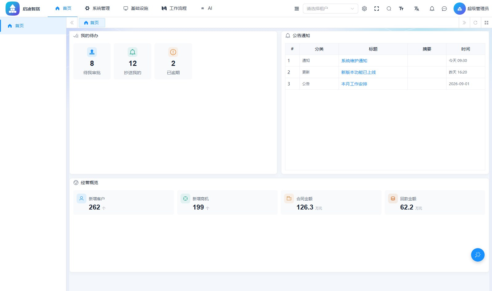

**启凌智搭**把「建一个企业内部应用」这件事，压缩成从一句话到一张能用的表单之间的距离：

> **在线建表** → **拖拽配表单** → **挂上菜单** → **自动派生权限** → **AI 助手直接用自然语言读写它** —— 全程不生成一行源码，运行时解释 JSON 产物。

传统低代码平台做到前四步就停了。启凌智搭多走了第五步：**AI 是平台的一等公民**，它读的是同一套权限体系，因此「AI 能看到的数据」和「这个人能看到的数据」永远一致 —— 不是靠提示词约束，是靠决策引擎拦。

---

## 🐶 新手必读

* **在线演示**：<https://demo.enlev.cn>
* **官方文档**：<https://doc.enlev.cn>
* **后端仓库**：[ainb](https://gitee.com/enlev/ainb)（本仓库）
* **Web 仓库**：[ainb-ui-admin-vue3](https://gitee.com/enlev/ainb-ui-admin-vue3)
* **移动端仓库**：[ainb-ui-admin-uniapp](https://gitee.com/enlev/ainb-ui-admin-uniapp)
* **五分钟跑起来**：见下文 [🚀 快速开始](#-快速开始)

### 演示账号

平台是 SaaS 多租户 + 资源授权模型，**同一个页面在不同身份下长得不一样**。五个账号密码均为 `admin123`：

| 视角 | 账号 | 租户名称 | 角色 | 能看到什么 | 用来演示 |
| --- | --- | --- | --- | --- | --- |
| 超管 | `admin` | 启凌智搭 | 超级管理员 | 全部菜单 + 顶部租户切换 | 全功能全貌 |
| 租户管理员 | `docadmin` | 启凌智搭 | 文档-租户管理员 | 本租户全部菜单（94 个叶子页） | 真实权限路径下的管理操作 |
| 套餐受限租户 | `aoteman` | test | 租户管理员 | 「普通套餐」内的 31 个叶子页 | 套餐决定可见菜单、多租户隔离 |
| 普通员工 | `salesman01` | 启凌智搭 | 销售专员 | 审批中心等 8 个叶子页 | 菜单缺失、无权限提示 |
| 行级权限用户 | `docsales` | 启凌智搭 | 文档-行级权限销售 | 9 个叶子页 | 行级 / 列级 / 字段级权限效果 |

> 🔴 **用超管账号测不出任何权限问题**：超管在决策引擎前就短路放行了。验证权限相关的改动，请换 `docadmin` / `docsales` / `salesman01`。

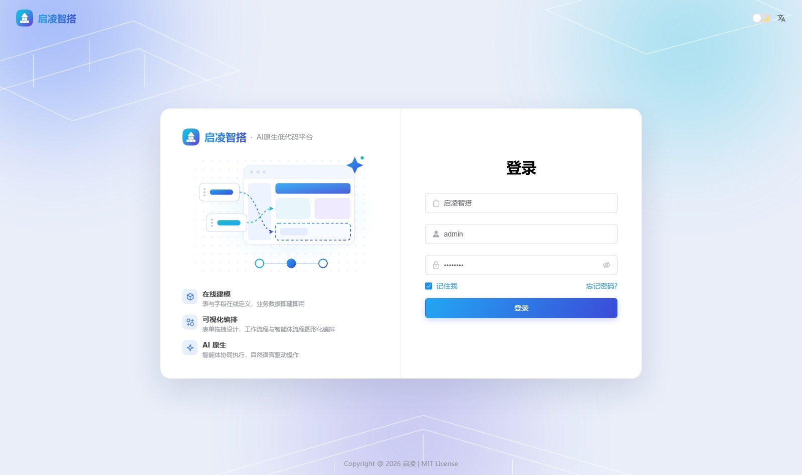

---

## 🐯 平台简介

Java 后端单体，根 pom 聚合 **8 个一级模块**（`enlev-framework` 下再分 **15 个子模块**）、**112 个 `@RestController`**、约 **38 万行 Java**（`src/main/java` 2,174 文件 24.9 万行 + `src/test/java` 477 文件 13.2 万行）；**440 个 `*Test.java`、5,164 个测试方法**（5,138 `@Test` + 23 `@ParameterizedTest` + 3 `@TestFactory`）。以上均为 2026-10-25 实测；上一版写的是「143 个 Controller、40 万行、464 个测试类、5450 个方法」（10-20 量的），中间 `12347efcd1`「清除未用上的模块」删掉了一批。

在上游芋道底座之上，本仓库增加了三块**完全自研**的能力：

| 能力 | 一句话 | 代码位置 |
| --- | --- | --- |
| ★ **低代码运行时** | 在线建表 → 配表单 → 挂菜单 → 派生权限 → 运行时解释 JSON 产物，不生成源码 | `enlev-module-infra` |
| ★ **ABAC 三层权限** | 功能 / 行 / 字段三层各自独立判定，`sys_*` 7 张表 + 决策引擎 + 权限诊断 | `enlev-module-system` |
| ★ **Agent 模块** | 工具体系、ReAct 循环、Plan 预览确认、图式工作流引擎、权限网关、用量计量 | `enlev-module-agent` |

此外还有一块**为移动端而加**的自研能力：分端导航树 `system_nav_node`（同样在 `enlev-module-system`）。它不算第四块平台能力，但它是移动端工作台**唯一**的菜单来源 —— 详见 [★ 分端导航树](#-分端导航树-system_nav_node)。

* **技术底座**：Spring Boot 3.5 多模块 + MySQL + MyBatis Plus + Redis / Redisson，JDK 17 编译目标（`eclipse-temurin:21-jre` 实测可跑）
* **多租户**：SaaS 多租户，租户套餐决定可见菜单，底层透明封装
* **低代码**：数据模型（在线 DDL）、表单设计与运行时、数据接口、门户设计、取号管理
* **权限**：Spring Security + Token + Redis，功能权限 / 行级权限 / 字段级权限三层独立判定，配**权限诊断页**把「配了但不生效」变成可查的排查路径
* **工作流**：Flowable 8，SIMPLE 仿钉钉设计器与 BPMN 设计器双轨，支持会签 / 或签 / 加签 / 退回 / 转办 / 委派
* **AI**：Spring AI 接入 OpenAI / Azure / Anthropic / DeepSeek / Ollama / 通义等主流模型，知识库 RAG、绘图、音乐、思维导图、写作，并暴露 MCP Server / Client
* **Agent**：自研智能体内核 —— 八类内置工具、ReAct 循环、写操作前 Plan 预览 + 人工确认（HITL）、图式工作流引擎、GraalJS 脚本沙箱、权限网关、用量配额
* **可观测**：Druid SQL 监控、Redis 监控、Java 监控、访问日志与错误日志、操作日志与登录日志
* **代码生成**：106 个 `.vm` 模板，一键生成 Java / Vue / SQL / 接口文档，支持单表、树表、主子表

> **上游与改名**：本仓库派生自 [ruoyi-vue-pro](https://gitee.com/zhijiantianya/ruoyi-vue-pro)（MIT，Copyright (c) 芋道源码），已整体改名 —— 包名 `cn.iocoder.yudao` → `cn.enlev.ainb`，构件前缀 `yudao-` → `enlev-`，产品名「启凌智搭」。

---

## 🐳 项目关系

| 仓库 | 技术栈 | 说明 |
| --- | --- | --- |
| **ainb**（本仓库） | Java 17 + Spring Boot 3.5 + Maven | 后端服务，端口 48080，产物 `enlev-server.jar` |
| **ainb-ui-admin-vue3** | Vue 3.5 + Vite 8 + Element Plus | Web 管理端，`src/` 下 887 个 `.vue` + 601 个 `.ts`，`pnpm dev` 起在 80 端口（`.env` 的 `VITE_PORT=80`） |
| **ainb-ui-admin-uniapp** | Vue 3.4 + uni-app 3.0 + wot-ui | 移动端，H5 起在 9000 端口（`env/.env` 的 `VITE_APP_PORT`），另出微信小程序 / App 产物 |

两个前端**共用本仓库这一个后端**：同一套 `/admin-api`、同一套权限体系与租户、同一套低代码产物。移动端不拥有任何私有接口契约，也不走代理，H5 直连 `VITE_SERVER_BASEURL`；小程序 / App 端还需把后端域名配进合法域名白名单。

本仓库为移动端额外提供一处**服务端驱动的导航树**（`system_nav_node`），使移动端工作台的菜单不必写死在前端代码里 —— 详见 [★ 分端导航树](#-分端导航树-system_nav_node)。

模块依赖是**单向**的：`agent → {ai, infra, bpm, system}`，且只调它们的 `api/` 包；没有任何模块反向依赖 agent（由 `AgentArchitectureTest#testOnlyDependOnApiLayer` 钉住）。agent 因此是严格的叶子模块 —— 这条约束不是洁癖，是因为**绕过 `api/` 直连 Service 就等于绕过行级权限**。

---

## 😎 开源协议

本项目采用比 Apache 2.0 更宽松的 **[MIT License](./LICENSE)** 开源协议：

① **个人与企业可 100% 免费使用**，可自由复制、修改、分发，也可用于商业用途，无需保留作者与 Copyright 信息。

② **代码全部开源**，不区分社区版与商业版 —— 低代码运行时、ABAC 三层权限、Agent 模块这三块自研能力，全在仓库里，没有加密 jar、没有授权服务器、没有「联系销售解锁」。

> ⚠️ 但**初始化 SQL 目前是分了「开源版 / 专业版」两份的**（`c3dccc1a82`），且精简的那份缺 64 张代码声明的表 —— 与这句声明并不一致。差异与「该导哪个」见[初始化数据库](#初始化数据库)，是否把表补回开源版 dump 是个待定的产品决策。

③ **架构可读**：模块边界由测试钉住（`AgentArchitectureTest`），约定由源码扫描式守卫钉住（`CommentLineRefBanTest`），踩过的坑写进 README 与手册，不靠口口相传。

本项目派生自上游开源项目，并内嵌第三方开源组件，完整归属见 [🙏 鸣谢](#-鸣谢) 与 [THIRD-PARTY-NOTICES.md](./THIRD-PARTY-NOTICES.md)。

---

## 🐼 内置功能

功能清单与[使用手册](https://doc.enlev.cn/guide/)的侧边栏严格一一对应，手册里每一页都有截图与多视角对照。

> * **★** 标记：本项目**自研**功能，上游没有对应物。
> * 无标记：继承自上游芋道底座，本项目做了适配与增强。

### 系统管理

|     | 功能 | 描述 |
| --- | --- | --- |
|     | 用户管理 | 用户是系统操作者，完成系统用户配置，左组织树 + 右用户表 |
|     | 组织管理 | 配置系统组织机构（公司、部门、小组），树形表格展现 |
|     | 岗位管理 | 配置系统用户所属担任职务 |
|     | 角色管理 | 角色菜单权限分配、数据范围划分、成员配置 |
| ★   | **角色资源授权** | 资源树勾选 + 批量授权 + 授权台账 + 生效结果回溯，是所有权限差异的唯一出处 |
| ★   | **权限资源** | 资源目录与明细设计（`DATASET` / `COLUMN` / `FIELD`），动作词表，槽位映射 |
| ★   | **权限规则** | 行级规则模板（如「仅自己的数据」），可复用于批量授权 |
| ★   | **权限诊断** | 「症状 → 根因 → 去哪查」的静默失效排查页，把不报错的权限问题变成可查 |
|     | 菜单管理 | 目录，下挂 **Web菜单**（`system_menu`：菜单、操作权限、按钮权限标识，Redis 缓存提升性能）与 ★ **App菜单**（`system_nav_node`：移动端工作台导航树，见[核心能力详解](#-分端导航树-system_nav_node)） |
|     | 租户管理 | 配置系统租户，支持 SaaS 场景下的多租户 |
|     | 租户套餐 | 自定义每个租户可见的菜单、操作、按钮权限 |
| ★   | 字典管理 | 字典分类与字典数据维护，支持导入导出与迁移包 |
|     | 地区管理 | 省份、城市、区镇三级地区，支持 IP 归属地查询 |
|     | 站内信 | 站内信模板与消息记录 |
|     | 通知公告 | 系统通知公告信息发布维护 |
|     | 操作日志 / 登录日志 | 系统操作与登录行为记录查询，含登录异常 |

### 基础设施

|     | 功能 | 描述 |
| --- | --- | --- |
|     | 配置管理 | 系统参数配置，内置与自定义混排 |
|     | 文件配置 / 文件列表 | 本地磁盘、数据库、S3 对象存储多种主配置，支持在线切换 |
|     | 定时任务 | Quartz 调度，任务编号二次确认、执行日志、失败详情 |
|     | 数据源配置 | 多数据源在线配置，配合 dynamic-datasource |
| ★   | **数据模型** | 在线建表与结构变更，DDL 执行日志可追溯到具体 SQL 与失败原因，支持导入已有表 |
| ★   | **数据查看** | 直接浏览物理表数据，支持合计行、多级分组表头、树形表格 |
| ★   | **数据接口** | 把一段 SQL / JSON / HTTP 变成可调用的取数端点，带在线测试面板与版本管理 |
| ★   | **取号管理** | 业务单据编号生成，重置周期与并发安全，带模拟取号测试与出号日志 |
|     | 代码生成器 | 106 个 `.vm` 模板，一键生成 Java / Vue / SQL / 接口文档，支持单表、树表、主子表 |
|     | 访问日志 / 错误日志 | API 访问与异常记录，可按结果码过滤 |
|     | 监控中心 | MySQL（Druid）、Redis、Java（Spring Boot Admin）三块监控 |

### 在线开发（低代码）★

|     | 功能 | 描述 |
| --- | --- | --- |
| ★   | **表单设计** | 表单列表 + 三态状态 + 线上版本 vN，发布 / 版本历史 / 回滚 / 复制 / 下线 |
| ★   | **表单设计器** | 分步设计器：基本信息、数据绑定、控件库拖拽、字段映射（可一键生成）、逻辑与扩展、列表设计、高级设置、设计期体检 |
| ★   | **表单运行时** | 解释 JSON 产物渲染真实页面：查询区、工具栏、合计列表、行内编辑 / 详情 / 打印、导入导出、左侧树筛选、标签页 |
| ★   | **门户设计** | 24 栏画布 + 四组控件库，属性面板三页签，门户预览按登录身份取数，版本管理与回滚 |
| ★   | **在线示例** | 控件与联动、表格呈现、校验体系、导入导出四组可跑的活样例 |

### 工作流程

|     | 功能 | 描述 |
| --- | --- | --- |
|     | 流程模型 | 四步向导：基本信息 → 表单设计 → 流程设计 → 更多设置；发布时 SIMPLE 树编译成 BPMN |
|     | 流程设计器 | **SIMPLE 仿钉钉设计器**与 **BPMN 设计器**双轨，节点间蓝色加号插入 |
|     | 审批节点 | 审批人设置 15 种方式、多人审批方式（会签 / 或签）、拒绝时行为、六个操作按钮可改名启用、逐字段设只读 / 可编辑 / 隐藏 |
|     | 流程表单 | 流程表单设计与预览，按真实填写态渲染 |
|     | 流程分类 / 用户分组 | 分类管理抽屉、分组成员多选 |
|     | 流程监听器 / 表达式 | 执行监听器（开始 / 结束）、任务监听器（创建 / 指派 / 完成 / 删除 / 更新 / 超时）、JUEL 表达式 |
|     | 审批中心 | 发起流程、我的流程、待办任务、已办任务、抄送我的、请假查询 |
|     | 流程实例 / 任务 | 实例取消（原因必填）、任务转办 / 委派 / 加签 / 退回，审批意见 + 附件 |

### AI 与 Agent

|     | 功能 | 描述 |
| --- | --- | --- |
|     | API 密钥 / 模型配置 | 密钥列打码，模型在线连通性测试（耗时、token 用量、厂商原始响应逐字回显） |
| ★   | **智能助手** | SSE 流式对话，「已深度思考」推理过程逐段展开，知识引用带可点来源与分段详情 |
| ★   | **智能体管理** | 五段式人设（身份 / 职责 / 依据 / 格式 / 边界）、知识库绑定、工具勾选、版本派生（改已发布的自动派生 vN） |
| ★   | **工具管理** | 内置工具 + 自定义工具（数据接口即工具），风险等级与「需确认」打标，每个可改项都挂着「代码默认」对照 |
| ★   | **流程编排 / 工作流编辑器** | 图式画布，13 种节点类型（基础 / 分支与并行 / 人工介入 / 高级），设计期体检 + 影响面面板（变更清单带预演标签与前后值），版本管理与 DSL 对比，执行历史与画布回放 |
| ★   | **Plan 预览与 HITL** | 写操作前先出草稿卡：变更预演自动展开，标明不可逆操作，用户「确认并运行」才落地 |
| ★   | **权限网关** | 工具调用前过权限与入参校验；被拒时不重试、不换工具绕，而是把缺的权限串原样告诉你 |
| ★   | **提示词模板** | 模板管理与占位符识别，聊天面板一键插入 |
| ★   | **用量看板 / 助手配置** | 按场景与按用户两个维度，配额告警条 + 统计卡 + 占比表 + 调用明细 |
|     | 知识库 | RAG 检索，向量库支持 Qdrant / Redis / Milvus，文档解析用 Tika |
|     | 绘图 / 音乐 / 思维导图 / 写作 | 上游 AI 域能力 |
|     | MCP Server / Client | 基于 Spring AI 的 MCP 双向支持 |

---

## 🐨 技术栈

### 模块

| 模块 | 职责 | 主源码 / 测试 |
| --- | --- | --- |
| `enlev-dependencies` | BOM，统一钉住全部第三方版本 | — |
| `enlev-framework` | `enlev-common` + 14 个 `enlev-spring-boot-starter-*`：`web` / `security` / `mybatis` / `redis` / `mq` / `job` / `excel` / `monitor` / `protection` / `websocket` / `test` / `biz-tenant` / `biz-data-permission` / `biz-ip` | 363 / 25 |
| `enlev-module-system` | 用户、组织、岗位、角色、菜单、租户与套餐、字典、地区、站内信、邮件短信、OAuth2、操作与登录日志；★ 自研权限体系、★ 分端导航树 | 575 / 87 |
| `enlev-module-infra` | 文件与文件配置、参数配置、定时任务、数据源配置、代码生成器、API 日志、监控；★ 低代码运行时（数据模型 / 表单设计 / 数据接口 / 门户 / 取号） | 469 / 124 |
| `enlev-module-bpm` | Flowable 8 工作流：流程模型、流程表单、分类、用户分组、监听器、表达式、实例与任务、抄送 | 265 / 36 |
| `enlev-module-ai` | 上游 AI 域：模型接入、知识库 RAG、对话、绘图、音乐、思维导图、写作、MCP Server/Client | 199 / 43 |
| `enlev-module-agent` | ★ **全自研**：智能体定义、工具管理、提示词模板、Plan 与人工确认、工作流编排、Webhook、用量看板与配额 | 298 / 161 |
| `enlev-server` | 启动装配与全部配置文件，产物 `enlev-server.jar`，端口 **48080** | 2 / 1 |

🔴 **`enlev-module-im` 不在 reactor 里** —— 根 `pom.xml` 把它注释掉了，`-pl enlev-module-im` 必然报「Could not find the selected project in the reactor」。目录残留是历史遗留，不要顺手「修好」它。

### 框架

| 框架 | 说明 | 版本 |
| --- | --- | --- |
| [Spring Boot](https://spring.io/projects/spring-boot) | 应用开发框架 | 3.5.15 |
| [MySQL](https://www.mysql.com/cn/) | 数据库服务器（日常开发与验证只针对 MySQL） | 8.x |
| [MyBatis Plus](https://mp.baomidou.com/) | MyBatis 增强工具包 | 3.5.16 |
| [mybatis-plus-join](https://github.com/yulichang/mybatis-plus-join) | 多表查询增强 | 1.5.7 |
| [Dynamic Datasource](https://dynamic-datasource.com/) | 动态多数据源 | 4.5.0 |
| [Druid](https://github.com/alibaba/druid) | JDBC 连接池与 SQL 监控 | 1.2.28 |
| [Redis](https://redis.io/) | key-value 数据库，`spring.cache.type: REDIS` 是**硬依赖** | 6+ |
| [Redisson](https://github.com/redisson/redisson) | Redis 客户端 | 4.6.1 |
| [Flowable](https://github.com/flowable/flowable-engine) | 工作流引擎 | 8.0.0 |
| [Spring AI](https://spring.io/projects/spring-ai) | AI 应用框架 | 1.1.8 |
| [Spring AI Alibaba](https://java2ai.com/) | `spring-ai-alibaba-graph-core`，Agent 图引擎底座 | 1.1.2.2 |
| [GraalVM Polyglot](https://www.graalvm.org/) | `polyglot` + `js`，工作流 script 节点的 JS 沙箱 | 24.1.2 |
| [Quartz](https://github.com/quartz-scheduler) | 任务调度组件 | 随 Boot |
| [Springdoc](https://springdoc.org/) | OpenAPI 文档 | 2.8.17 |
| [Knife4j](https://doc.xiaominfo.com/) | Swagger 增强 UI | 4.5.0 |
| [MapStruct](https://mapstruct.org/) | Java Bean 转换 | 1.6.3 |
| [Lombok](https://projectlombok.org/) | 消除冗长的 Java 代码 | 1.18.46 |
| [Hutool](https://hutool.cn/) | Java 工具库 | 5.8.46 |
| [JUnit 5](https://junit.org/junit5/) + [Mockito](https://github.com/mockito/mockito) | 单元测试框架 | 随 Boot |

版本全部由 `enlev-dependencies/pom.xml` 统一管理，业务模块不写版本号。根 pom 用 `flatten-maven-plugin` 展开 `${revision}`，**改版本号只改根 pom 一处**（当前 `2026.07-SNAPSHOT`）。

---

## 🚀 快速开始

### 前置条件

| 组件 | 要求 | 说明 |
| --- | --- | --- |
| JDK | 17+ | 根 `pom.xml` 的 `<java.version>17</java.version>` |
| Maven | 3.6+ | **仓库没有 `mvnw`**，只能用 PATH 上的 `mvn` |
| MySQL | 8.x | 库名 `ainb-professional-init`（`application-local.yaml` 里写死，见下文[初始化数据库](#初始化数据库)） |
| Redis | 6+ | 没有 Redis 起不来，`spring.cache.type: REDIS` 是硬依赖 |

**不需要**装的东西（容易白折腾）：Nacos（全仓 pom 零命中）、XXL-Job（用的是 Quartz，且 local profile 直接 `exclude` 了 `QuartzAutoConfiguration`）、RocketMQ / Kafka（WebSocket `sender-type: local`）、对象存储（infra 文件服务可用本地磁盘或数据库）。

### 初始化数据库

SQL 在 `sql/mysql/`。🔴 **本仓没有任何自动建表机制**（无 Flyway / Liquibase / `spring.sql.init`），库里的表**全部**来自下面的脚本，导错了后端能启动但页面会报「表不存在」。

| 文件 | 实测内容 | 什么时候用 |
| --- | --- | --- |
| `ainb-professional-init.sql` | 40 MB / **211 张表**，Source Schema `ainb-professional-init`，dump 于 2026-10-22 | 🔴 **全新环境导这个**（库名与 `application-local.yaml` 一致）。⚠️ 但它**完全没有** `system_nav_node`（只有 14270 行被手工补进去的 `infra_form_design.app_nav_node_id`，注释还引用着这张不存在的表），导完必须跑下面的增量脚本 |
| `sql/mysql/update/*.sql` | 6 个增量迁移（2026-10-24）：`system_nav_node` 建表、导航树种子、App菜单 菜单与资源行、菜单管理拆 Web/App、表单发布到 App 端 | **导完全量后按下方给定顺序跑一遍**，🔴 不能用 `*.sql` 通配（字母序会踩脚本头部声明的前置依赖） |
| `ainb-init.sql` | 13 MB / **95 张表**，Source Schema `ainb-public-init`，dump 于 2026-10-22；只含 `act_*`(39) / `flw_*`(6) / `graph_*`(2) / `system_*`(34) / `sys_*`(7) / `infra_*`(7) | ⚠️ 见下方红字，**不能单独用来起服务**。它反倒**含** `system_nav_node` 的建表（8477 行）与 App菜单 菜单/资源行，但**零条种子数据** |
| `quartz.sql` | `qrtz_*` 11 张 | professional dump 已含；local profile 直接 `exclude` 了 `QuartzAutoConfiguration`，一般用不到 |
| `ruoyi-vue-pro.sql` | 上游基线 | 只用于与上游对比，**不要导** |

🔴 **`ainb-init.sql` 缺 64 张代码里 `@TableName` 声明的表**（全仓 112 张，dump 里只有 95 张，2026-10-25 实测）：`agent_*` 全 16 张、`infra_*` 17 张（含 `infra_data_model` / `infra_form_design` / `infra_data_interface` / `infra_portal` / `infra_bill_template` 这些低代码核心表，也含 `infra_codegen_table` / `infra_codegen_column` —— **连代码生成器自己都不能用**）、`ai_*` 全 13 张、`bpm_*` 11 张、`enlev_demo0*` 5 张，另缺全部 `qrtz_*` 11 张（Quartz 自建表不走 `@TableName`，但 local profile `exclude` 了 `QuartzAutoConfiguration` 所以本地不炸，dev / prod 会）。只导它的话后端能起来，但 **AI / Agent / 工作流 / 低代码四大块页面一律报「表不存在」**。它是 `c3dccc1a82`「区分专业版和开源版」裁剪出来的精简 schema，不是完整初始化脚本。

反过来 `ainb-professional-init.sql` 也不是齐的：它缺 `system_nav_node`（见上表）与 `enlev_demo0*` 那 5 张代码生成示例表。**两份 dump 在 nav-node 这件事上正好是反的** —— 开源版「有新特性、缺平台表」，专业版「平台表齐、停在 nav-node 之前」。

```bash
mysql --default-character-set=utf8mb4 -h127.0.0.1 -uroot -p123456 \
  -e "CREATE DATABASE IF NOT EXISTS \`ainb-professional-init\` DEFAULT CHARACTER SET utf8mb4 COLLATE utf8mb4_unicode_ci"
mysql --default-character-set=utf8mb4 -h127.0.0.1 -uroot -p123456 ainb-professional-init < sql/mysql/ainb-professional-init.sql

# 再按【依赖顺序】跑 6 个增量迁移 —— 🔴 顺序不能换成 update/*.sql 通配：
# 字母序是 form-design-app-nav → menu-manage-split-web-app → nav-node-prune-undelivered
#        → system-nav-node → system-nav-node-menu → system-nav-node-seed
# 那会让 menu-manage-split-web-app 跑在它头部声明的 🔴 前置（三个 system-nav-node*）之前，
# 并让 prune 跑在 seed 之前（等于没裁）。
U=sql/mysql/update
for f in $U/2026-10-24-system-nav-node.sql \
         $U/2026-10-24-system-nav-node-seed.sql \
         $U/2026-10-24-nav-node-prune-undelivered.sql \
         $U/2026-10-24-system-nav-node-menu.sql \
         $U/2026-10-24-menu-manage-split-web-app.sql \
         $U/2026-10-24-form-design-app-nav.sql; do
  mysql --default-character-set=utf8mb4 -h127.0.0.1 -uroot -p123456 ainb-professional-init < "$f"
done
```

6 个脚本**都做了幂等处理**（建表用 `IF NOT EXISTS`、加列用 `information_schema` 判重、种子与菜单行开头按语义键清既有行再按显式 id 重插），可重复执行。但其中两个「幂等」是靠**先删后插**实现的，重跑有副作用，脚本头部都写了：`-seed.sql` 会覆盖后台对 app 导航树的人工编辑，`-nav-node-menu.sql` 会清掉指向旧 `sys_resource` 行的 `sys_grant` 授权 —— **只在首次迁移 / 刻意重置时跑**。

🔴 **跑完增量脚本必须重启后端**：`sys_resource` 的祖先链有进程级缓存且无 TTL（`GrantDecisionService#resourceChainCache`），`menu-manage-split-web-app.sql` 改了资源 9000100036 的 `path` / `menu_id`，不重启则非超管的授权判定仍按旧链走。`system_menu` 侧只有 Redis 短 TTL 缓存，不受影响。

导航树种子（`*-nav-node-seed.sql`）灌的是**移动端**的导航节点（裁剪后 4 分组 / 14 子分组 / 64 项），Web 端菜单不读它；不跑的话移动端工作台是空的，Web 端不受影响。

`sql/` 下另有 `oracle` / `postgresql` / `sqlserver` / `dm` / `kingbase` / `opengauss` / `highgo` / `db2` 八种方言目录与 `sql/tools/convertor.py` 转换脚本（`sql/tools/README.md` 有用法）；**日常开发、单测与手册截图全部只跑 MySQL**，其他方言不保证与 `ainb-professional-init.sql` 同步。

### 确认配置

配置在 `enlev-server/src/main/resources/`：`application.yaml`（公共）+ `application-{local,dev,prod}.yaml` + `logback-spring.xml`。`application.yaml` 里 `spring.profiles.active: local`，本地开发只看 `application-local.yaml`。

| 配置项 | local 的值 |
| --- | --- |
| `server.port` | `48080`（**不在 `application.yaml`**，三个 profile 各写一份） |
| `spring.datasource.dynamic.datasource.master.url` | `jdbc:mysql://127.0.0.1:3306/ainb-professional-init?...` |
| `spring.datasource.dynamic.datasource.slave` | `lazy: true`，不连也不报错 |
| `spring.data.redis` | `127.0.0.1:6379` / `database: 0`，`password` 行是注释掉的 |

local profile 另外关掉了图片验证码（`enlev.captcha.enable: false`）与访问日志（`enlev.access-log.enable: false`），并设 `demo: false`。`root/123456` 是**本地演示库**的口令，不要照抄到生产。

🔴 **模拟登录 `enlev.security.mock-enable` 在 local 也是 `false`**（手册里写的 `true` 已过期，以代码为准），别为了省事打开：开着等于「`Authorization: test1` 即超管」，任何打到 48080 的请求都能冒充任意用户，而本地服务常被局域网内其他机器访问。真要模拟登录，先把 `mockSecret` 改成不可猜的值再临时打开（配置文件里的 🔴 注释写了完整理由）。

### 启动

IDE 里直接跑主类 `enlev-server/src/main/java/cn/enlev/ainb/server/EnlevServerApplication.java`。命令行：

```bash
mvn -pl enlev-server -am -DskipTests spring-boot:run
```

### 验证跑通了

| 检查 | 命令 / 地址 | 期望 |
| --- | --- | --- |
| 后端活着 | `curl -s http://127.0.0.1:48080/admin-api/system/auth/get-permission-info` | `{"code":401,"msg":"账号未登录"}` —— 401 说明服务通了，只是没带 token |
| 接口文档 | <http://127.0.0.1:48080/doc.html> | knife4j 页面，HTTP 200 |
| 全链路 | 起前端后访问 <http://localhost>，`admin / admin123` 登录 | 进首页，左侧菜单完整 |

接口路径前缀：管理端 `/admin-api`，用户端 `/app-api`。knife4j 的分组按模块的 `GroupedOpenApi` bean 划分，现有 `ai` / `all` / `bpm` / `infra` / `system` 五组 —— **没有 `agent` 分组**，agent 的接口在 `all` 里。

### Docker

`script/docker/docker-compose.yml` 定义了四个服务：`mysql:8`、`redis:6-alpine`、`enlev-server`（后端）、`enlev-admin`（前端），配合 `docker.env` 与 `script/docker/Docker-HOWTO.md` 使用；`enlev-server/Dockerfile` 基于 `eclipse-temurin:21-jre`，暴露 48080，`JAVA_OPTS` 可用 `-e` 覆盖。

🔴 `Docker-HOWTO.md` 里提到的 `script/docker/ainb-ui-admin/`（含 `nginx.conf`）**在仓库中不存在**，前端镜像需要自己补 Dockerfile 与 nginx 配置。这套脚本的定位是「快速体验依赖关系」，不是可直接照抄的生产部署链。

---

## 🏗️ 核心能力详解

### ★ 低代码运行时（`enlev-module-infra`）

上游只有代码生成器（产出 Java/Vue 源码，脱离平台运行）。本项目的低代码是**运行时解释 JSON 产物**，一条业务功能从零到能用要走五段：

| # | 阶段 | 干什么 | 关键类 |
| --- | --- | --- | --- |
| 1 | **数据模型** | 在线建物理表，DDL **不可回滚**，执行日志留档 | `DataModelServiceImpl` → `DdlExecutor` |
| 2 | **表单设计** | 设计器拖出表单，发布 JSON 产物（`@Transactional` 六步，逐列核对物理表） | `FormDesignServiceImpl#publish` |
| 3 | **建菜单** | 发布只返回 `MenuConfig`，由前端调 `/system/menu/create` 再回调 `bind-menu`，落 `infra_form_design_menu`（1 菜单 + 7 按钮） | — |
| 4 | **派生权限** | 事件驱动登记资源与槽位：`FormDesignPublishedEvent`（同步、同事务）→ 五步登记 `sys_resource` 的 `DATASET/COLUMN/FIELD` 与 `sys_slot_mapping` | `DatasetResourceServiceImpl#register` |
| 5 | **表单运行时** | 读产物拼原生 SQL，叠加行过滤与字段裁剪 | — |

| 数据模型：在线建表 | 表单设计器：控件库 + 画布 + 配置面板 |
| --- | --- |
| 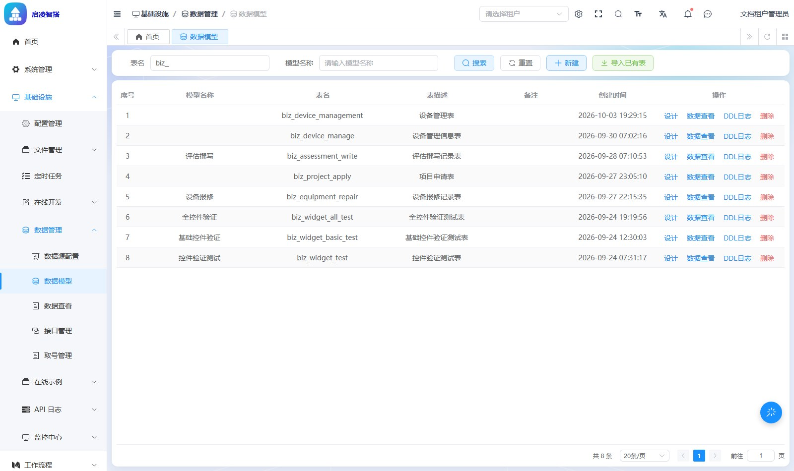 | 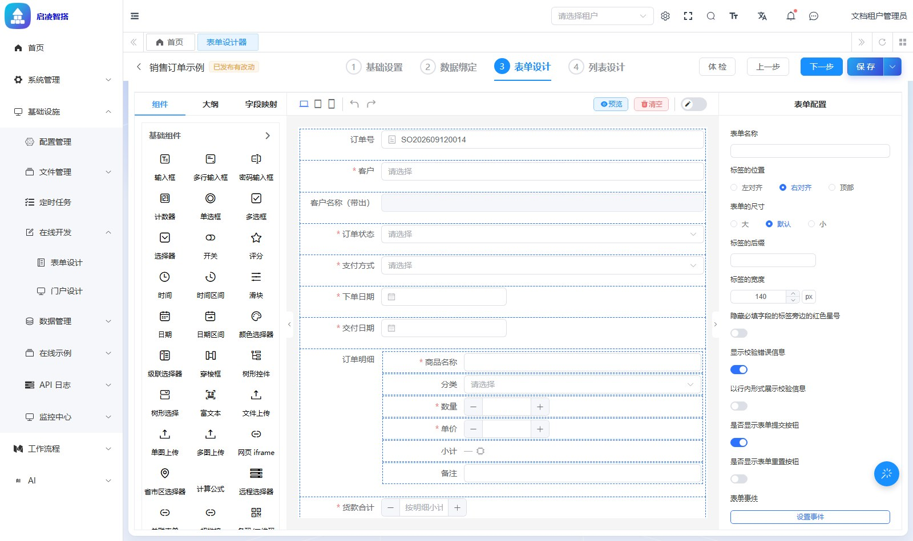 |

| 首次发布：需要选择上级菜单 | 表单运行时：发布完直接能用的列表页 |
| --- | --- |
| 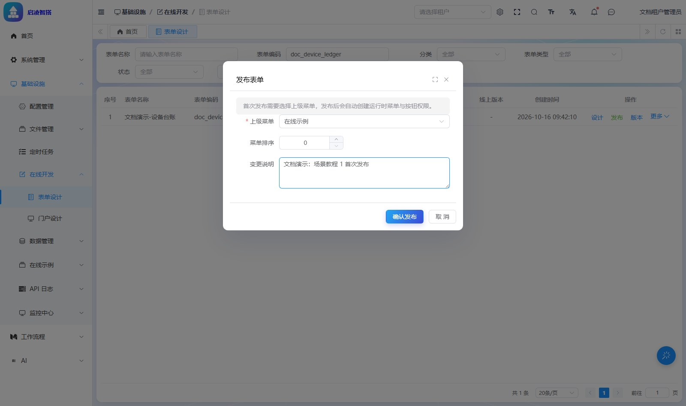 | 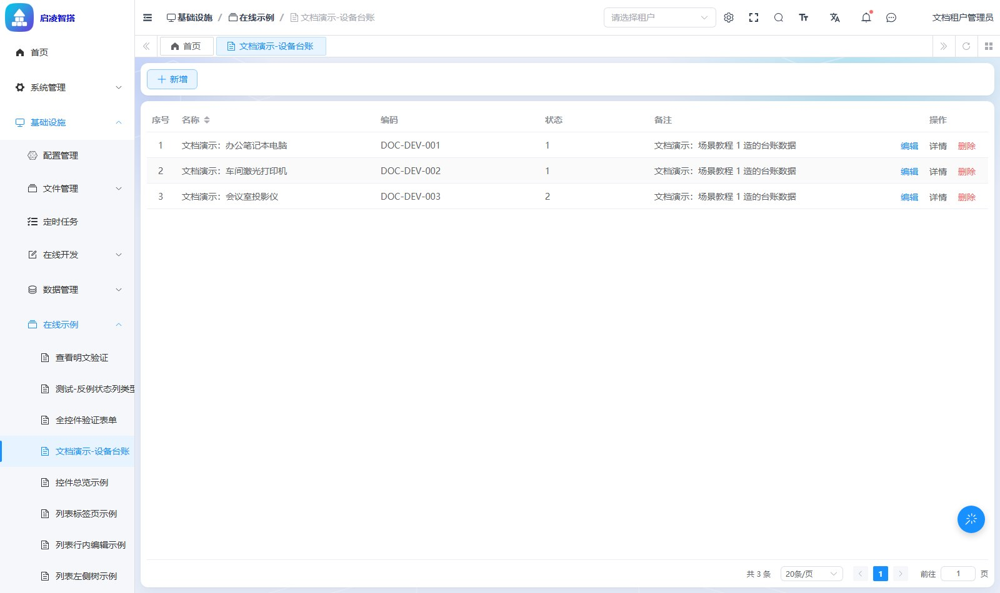 |

段与段之间**只通过数据库表和 Spring 事件耦合**，没有跨模块方法调用。

另有三块配套能力：

* **数据接口** —— 把一段 SQL / JSON / HTTP 变成可调用的取数端点，带在线测试面板与版本管理。🔴 注意它**完全没有行级权限**，这是[让 AI 助手安全读写业务数据](https://doc.enlev.cn/guide/05-scene/ai-safe-data)专门演示的一个坑。
* **门户** —— 首页看板布局协议与发布，24 栏画布，预览按登录身份取数。
* **取号管理** —— 业务单据编号生成与并发安全，带模拟取号测试与出号日志。

| 数据接口：SQL 编辑区 + 表结构树 + 内置变量 | 门户设计器 | 取号管理 |
| --- | --- | --- |
|  | 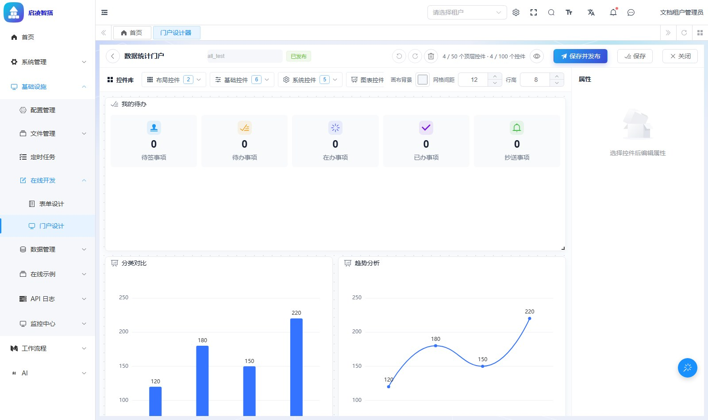 |  |

### ★ 三层权限体系（`enlev-module-system`）

上游只有 `system_role_menu` 加一个 `@DataScope`。本项目自研了 `sys_` 前缀 7 张表、决策引擎、行级规则、字段模式、记录共享与权限诊断页：

| 层 | 判什么 | 产物 | 入口 |
| --- | --- | --- | --- |
| **功能权限** | 能不能调这个接口 | boolean | `GrantDecisionEngine#explain` |
| **行级** | 这个接口能查出哪些行 | 一段 SQL 条件 | `DataRowFilterResolver` |
| **列 / 字段级** | 查出来的行里哪些列能看、能改 | `EDITABLE / READONLY / HIDDEN` | `PermissionFieldCrop` |

判定顺序是「主体闭包 → 资源祖先链（物化路径）→ 全局 DENY > 上下文 DENY > 上下文 ALLOW > 全局 ALLOW → 回落 `sys_resource.default_effect`」。

🔴 **三层不共享判定结果**：配了 `query` 的 ALLOW 不等于能看到任何一行数据。下面两张图是同一个接口、同一段代码，管理员看到 8 行含「联系邮箱」列，行级权限用户只看到 2 行、整列消失：

| 租户管理员视角：8 条、含「联系邮箱」列 | 行级权限用户视角：2 条、联系邮箱整列消失 |
| --- | --- |
| 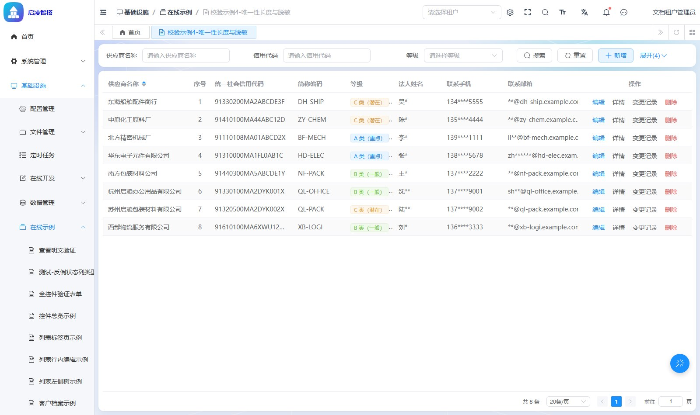 | 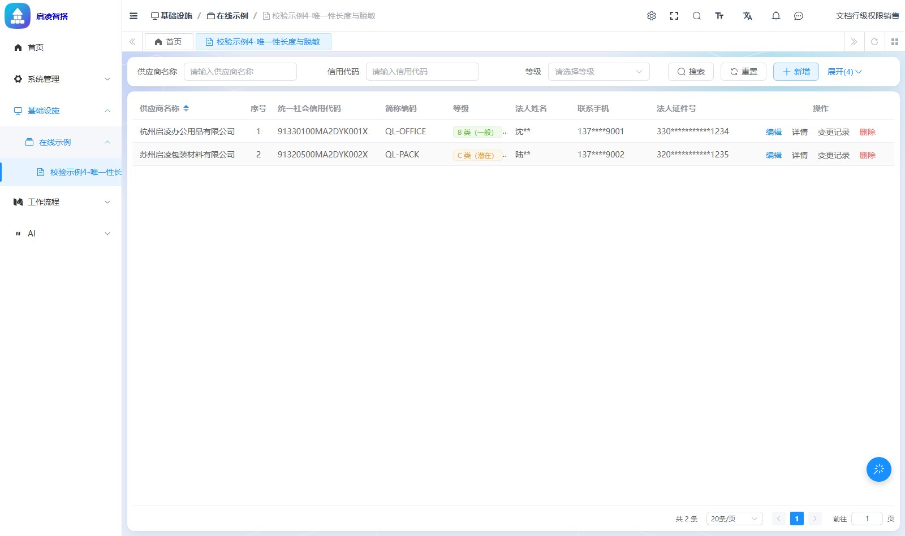 |

字段级同样独立判定 —— 下图是受限视角打开编辑弹窗：**联系手机只读、法人证件号整个字段不出现**。

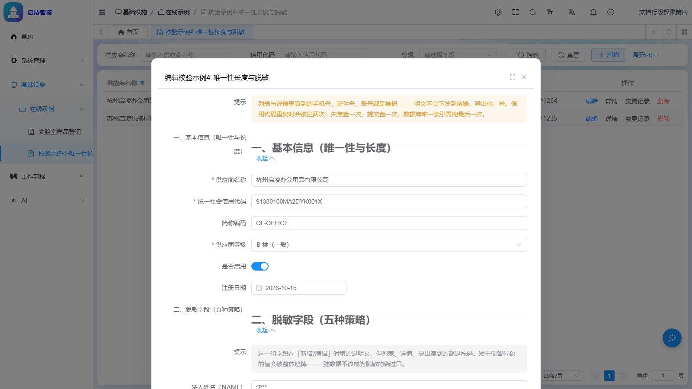

新旧两套并存，开关在 `enlev.permission` 下，当前 `application.yaml` 里 `grant-enabled: true`、`collapse-enabled: true`（注意 `PermissionProperties` 的**默认值与 yaml 不一致，以 yaml 为准**）。

🔴 **行权限在拿不到 `userId` 时是放行的**，字段权限同样，两者都只打一条 warn。给 agent 开一条直连 Service 的口子等于绕过行权限 —— 这正是「只走 `api/`」这条架构约束存在的原因。

**权限诊断页**是这套体系的配套工具：权限失效大多**不报错**（资源没登记、规则没挂、动作词写错），诊断页把「症状 → 根因 → 去哪查」摊开成可查的路径。

| 资源树授权：角色 → 资源 × 动作 × 效果 | 权限诊断：症状 → 根因 → 去哪查 |
| --- | --- |
| 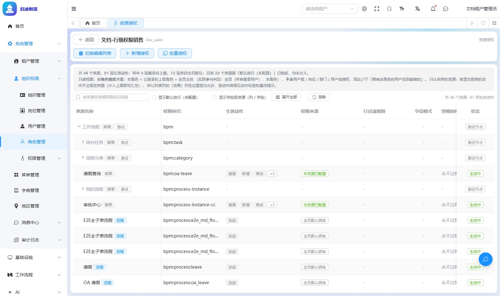 | 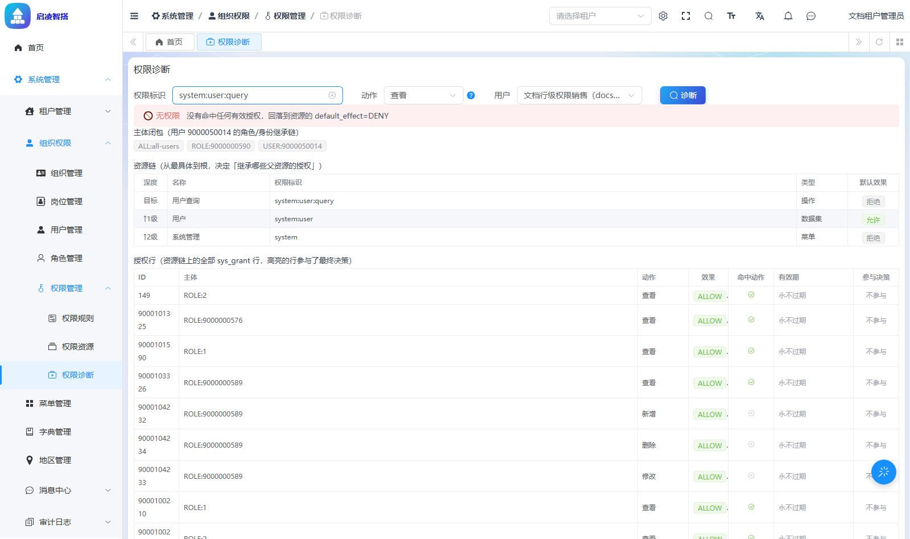 |

### ★ 分端导航树 `system_nav_node`

移动端（`ainb-ui-admin-uniapp`）工作台的菜单**不在前端代码里写死**。早期方案是前端维护一份 `src/pages/index/menu.json` 静态快照（**347 行：14 分组 / 59 子分组 / 274 个导航项**，实测自该文件被删前的 `95426b57^`），代价是每次后端菜单变动都要手工同步，必然漂移。现在改为**服务端下发**（`95426b57`「工作台菜单改为服务端驱动，退役 menu.json」）：登录后按端拉一棵过滤过的导航树，裁剪后规模是 **82 行：4 分组 / 14 子分组 / 64 项**（10 个未交付模块的 265 行被硬删，见 `sql/mysql/update/2026-10-24-nav-node-prune-undelivered.sql`）。

| 关注点 | 实现 |
| --- | --- |
| 表 | `system_nav_node` —— 每端一棵**自引用树**（`terminal` + `parent_id`），与 `system_menu` **完全独立**，索引 `idx_terminal_parent(terminal, parent_id)` |
| 节点类型 | `node_type`：1=分组 2=子分组 3=导航项；只有导航项带 `route`（须命中移动端 `pages.json`） |
| 端上展示字段 | `icon`（wot-ui 图标名）、`icon_color`、`is_tabbar`（决定 `switchTab` vs `navigateTo`）、`only_pc`（点了跳「仅 PC」提示页）、`query`（如在线表单的 `code=xxx`） |
| 权限挂接 | `permissions` 是逗号分隔的权限串，**任一命中即可见**，空串=不设门槛。权限串复用 `sys_resource` / `system_menu` 那套，**不另建一套授权模型** |
| 端点 | `GET /system/nav-node/tree` —— 移动端消费，**仅需登录**，按当前用户授权过滤；`@DataPermission(enable = false)`，与 `get-permission-info` 同源取权限集合 |
| 编辑器 | `GET /list`（**未过滤**，才能看到全部节点去编辑）+ `GET /get` + `create` / `update` / `update-sort`（拖拽排序，同一事务落库）/ `delete` / `delete-list`，逐个挂 `@PreAuthorize("@ss.hasPermission('system:nav-node:*')")` |
| 代码 | `NavNodeController` / `NavNodeService(Impl)` / `NavNodeDO` / `NavNodeMapper` / `NavNodeTypeEnum` + 5 个 VO，都在 `enlev-module-system` 的 `permission` 包下；错误码占用 `1-002-036-000` 号段（7 个）；有配套单测 `NavNodeServiceImplTest` |
| Web 侧入口 | 系统管理 ▸ 菜单管理 ▸ **App菜单**（`src/views/system/navNode/`，菜单 9000050016~019，资源 9000100900~904） |

剪枝是**两条规则叠加**（`NavNodeServiceImpl#buildVisibleChildren`）：

1. 节点自身门槛：`status` 正常 + `visible=1` + `permissions` 命中；
2. 分组 / 子分组在自身门槛通过后，还须**至少有一个可见子节点**，否则整枝隐藏；导航项只看自身门槛。

因为规则 1 已含 `status`，停用的分组会在这一层被跳过、不再递归其子节点，于是「停用则整枝不展示」自然成立，不需要再单独级联一次。

🔴 **`system_menu` 与 Web 路由生成一字未动**，Web 端零回归；`AuthController` / `AuthConvert` / `getPermissionInfo` 也没碰。两套导航树的边界是：**Web 菜单管后台左侧栏，App菜单管移动端工作台**。`menu_ref_id` 是给「同一能力在两棵树里各有一行」留的指回 `system_menu.id` 的标记位，但**种子里 82 行全为 NULL，且全仓 Java 只有 DO 与两个 VO 声明了这个字段、没有任何 Service 读它** —— 它当前纯粹是「可在编辑器里填、能存能回显」的预留位，不要以为存在某种自动关联或级联判定。

**在线表单也能发布到 App 端**：`infra_form_design.app_nav_node_id` 登记该表单在导航树上的节点编号。发布走**前端编排的两步式** —— `publish` 返回 `needCreateNavNode` 与 `navNodeConfig`，前端调 `/system/nav-node/create` 落地后回调 `POST /infra/form-design/bind-app-nav` 写回编号；下线时把该列显式置 NULL。之所以绕前端，是因为 **infra 不能反向依赖 system**，与既有的 `menu_id` / `bind-menu` 完全同一个范式。

> ⚠️ **`ainb-professional-init.sql`（唯一能起完整服务的那份）里没有这张表**，也没有 App菜单 的 9 行菜单/资源行 —— 它是 10-22 的快照，之后只被手工补进了 `infra_form_design.app_nav_node_id` 一列（14270 行，注释还引用着这张不存在的表）。开源版 `ainb-init.sql` 反倒含建表与那 9 行，但**零条种子数据**，而且它缺 64 张平台表、单独用不起来。所以无论导哪份，都必须按[初始化数据库](#初始化数据库)把 `sql/mysql/update/` 的 6 个脚本按依赖顺序跑一遍，否则 App菜单 页与 `/system/nav-node/tree` 会报表不存在、移动端工作台会是空的。

### ★ Agent 模块（`enlev-module-agent`）

整个模块自研，上游没有对应物。**独立成模块而不是并进 `enlev-module-ai`**，理由写在 `enlev-module-agent/pom.xml` 的 `<description>` 里：ai 模块的提交全部来自上游且仍在活跃维护，agent 代码若与它同目录交织，每次 merge 都要人工判断。

| 子域 | 包 | 内容 |
| --- | --- | --- |
| 执行内核 | `framework/agent/core/engine` | 基于 spring-ai-alibaba-graph-core 的有状态图引擎：`compiler` / `dsl` / `executor` / `context` / `io` / `trace` / `trigger` |
| Agent 循环 | `core/loop`、`core/react`、`core/chat` | ReAct 循环与对话编排 |
| Plan 与人工确认 | `core/plan`、`service/plan` | 写操作前先出 Plan 预览，用户确认后才执行（HITL） |
| 工具体系 | `core/tool`、`tool/impl` | 八类内置工具：`datainterface` / `datamodel` / `diagnostic` / `doc` / `explain` / `form` / `formdata` / `process` |
| 权限网关 | `core/gateway`、`core/security`、`core/validate` | 工具调用前过权限与入参校验；Webhook 匿名入口带限流与载荷净化 |
| 计量与配额 | `dal/*/usage`、`dal/*/quota`、`job` | 用量看板、配额闸门、计量日志保留期清理 |
| 配置面 | `framework/agent/config` | 8 个 `@ConfigurationProperties`：`AgentChat/Intent/Loop/Plan/Sanitize/Usage/Webhook/Doc` |

脚本节点用 GraalJS 沙箱执行用户脚本。16 张 `agent_*` 表与 16 个 `*DO.java` 严格 1:1。

🔴 该模块在自己 pom 里用 `spring-ai-bom` **本地钉住** Spring AI 版本（1.1.8），以覆盖 `spring-ai-alibaba-graph-core:1.1.2.2` 传递进来的 1.1.2 —— **是刻意为之，不要「修正」**。

**AI 助手是这套内核的用户界面**：流式对话、推理过程可展开、知识引用可点到手册原文分段。


**写操作走 Plan + 人工确认**，不是「AI 说干就干」。下面两图是同一句「帮我建一张样品登记表」的现场：AI 先把需求拆成一串节点，再给出草稿卡（状态「待确认」+ 变更预演清单，标明哪些操作不可逆），用户点「确认并运行」才落地。

| 规划中：把需求拆成一串工具调用 | 规划完成：草稿卡「待确认」+ 9 个节点 |
| --- | --- |
| 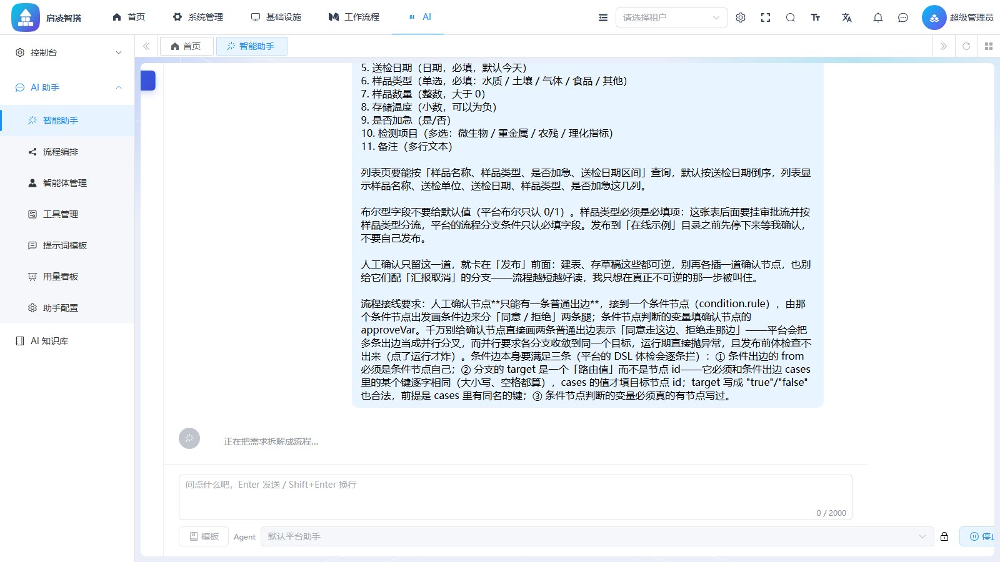 |  |

**工作流编辑器**是同一套引擎的手动入口：13 种节点类型、设计期体检、影响面面板（变更清单带预演标签与前后值）、版本管理与 DSL 对比、执行历史与画布回放。

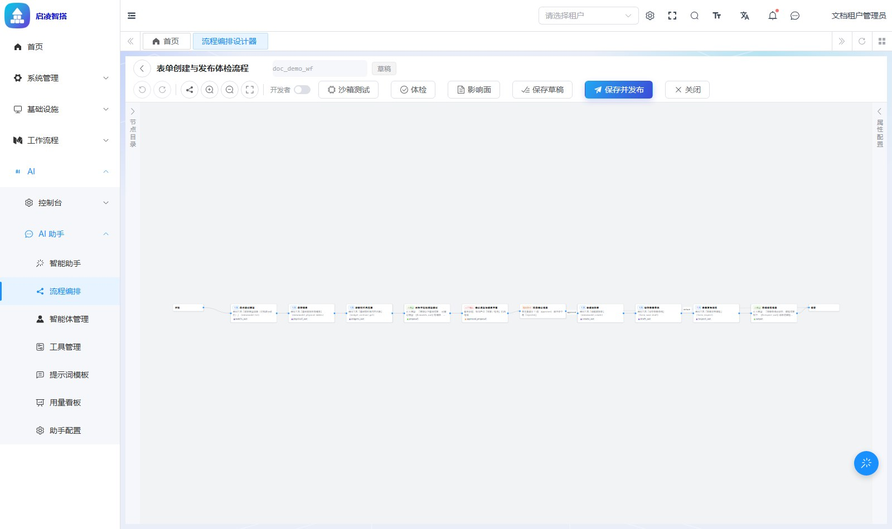

🔴 **AI 不绕过权限**。下图是 `docsales`（行级权限用户）问同一个问题，AI 只读到 2 条 —— 行级权限对 AI 同口径生效，靠的是权限网关而不是提示词：

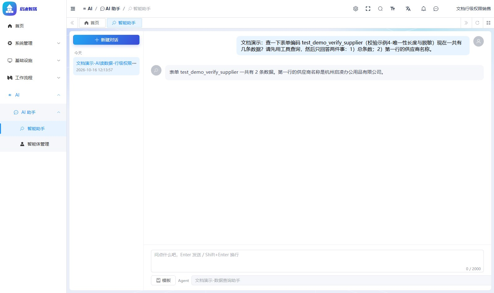

**内置知识库**：AI 助手有一个「平台产品手册（AI 助手内置）」知识库，语料是手册仓库的 markdown 源（`xpy-blog/docs/{guide,develop}`，不抓线上 HTML —— 抓回来要过 Tika，抽出的是纯文本、丢标题层级，切分质量明显更差）。`enlev.agent.doc.root-path` **必须显式配置**：留空则同步接口直接报错（`AGENT_DOC_ROOT_PATH_MISSING`），配的不是目录则报 `AGENT_DOC_ROOT_PATH_INVALID`；正确值是手册仓库的 `docs` 目录，本机是 `C:/code/xpy-blog/docs`。`base-url` 默认 `https://doc.enlev.cn`，用于把相对路径映射成可点链接。同步走诊断端点 `POST /doc-sync`，配 `doc-sync-plan` / `doc-sync-status` / `doc-sync-verify` 三个查询端点，**刻意不做定时 job**（语料只随版本变）。

> 🔴 **三个 profile 现在把 `root-path` 配成了 `/`**（`application-{local,dev,prod}.yaml` 的 `enlev.agent.doc.root-path`）。这个值能通过校验 —— `/` 确实是个目录（Windows 下解析成当前盘根）—— 但 `/guide`、`/develop` 都不存在，于是 `planSync` 对每个子目录各记一条「子目录不存在，已跳过」warning、最终扫出 **0 篇**。接口返回 200、计数全 0，看着像「跑成功了、只是暂时没文档」，正是 `AgentDocProperties` 类注释里点名要消灭的那种「配了但不生效」形状，只是这次至少有 warning 可查。部署机的语料路径因环境而异，不宜写死进仓库，因此这里只记明现状、不改配置。

### AI 域（`enlev-module-ai`）

模型接入基于 Spring AI：OpenAI、Azure OpenAI、Anthropic、DeepSeek、Ollama、Stability AI、DashScope（通义）。`application.yaml` 的 `enlev.ai.*` 下另有 Gemini、豆包、混元、硅基流动、讯飞星火、百川、文心一言、智谱、MiniMax、Moonshot、阶跃星辰、Grok、Midjourney、Suno 与联网搜索的开关与密钥位（默认 `enable` 的一半是关的，按需打开并配 `*_API_KEY` 环境变量）。向量库支持 Qdrant / Redis / Milvus，文档解析用 Tika，并暴露 MCP Server（webmvc）与 MCP Client。

### 工作流（`enlev-module-bpm`）

Flowable 8，`database-schema-update: true`、`history-level: audit`、`check-process-definitions: false`（禁用 `resources/processes` 自动部署）。前端提供两套设计器：bpmn-js 的 BPMN 设计器，与简化版 `SimpleProcessDesignerV2`（`src/views/bpm/simple/`）；发布时 SIMPLE 树被编译成 BPMN、条件编译成 JUEL 表达式。

| SIMPLE 设计器：发起人 → 部门审批 → 抄送财务 → 结束 | BPMN 设计器：bpmn-js 画布 + 属性面板 |
| --- | --- |
|  |  |

---

## 🛠️ 工程约定（改代码前必读）

1. 🔴 **模块是扁平 jar，没有 `-api` / `-biz` 拆分** —— 这是与上游最大的结构差异。`api` 只是同一构件里的一个 package。标准分层：

   ```
   enlev-module-<x>/src/main/java/cn/enlev/ainb/module/<x>/
     api/ controller/ convert/ dal/{dataobject,mysql}/ enums/ framework/ job/ mq/ service/ util/
   ```

   代码生成器模板（`enlev-module-infra/src/main/resources/codegen/`，106 个 `.vm`）已按扁平结构写好；把上游的拆分方式「改回来」会直接破坏代码生成与编译。

2. 🔴 **改了代码生成模板必须重新打包**：`.vm` 嵌在 `BOOT-INF/lib/enlev-module-infra-*.jar` 内，由 `CodegenEngine` 从 classpath 读，改完刷新页面不生效。只改 infra 时可以 `mvn package -pl enlev-module-infra,enlev-server -am -DskipTests` 省时间。

3. **判断某功能是上游自带还是本项目定制**，看 [内置功能](#-内置功能) 的 ★ 标记与「核心能力详解」一节，不要凭记忆下结论。

4. **`ainb` 与 `ainb-ui-admin-vue3` 都没有 `docs/` 目录**，代码注释里引用的 `docs/*.md` 已不存在，别去找。产品手册与开发手册在独立的手册仓库 `xpy-blog`（`docs/{guide,develop}`），通过 `enlev.agent.doc.root-path` 指过去。移动端仓库里那个 `ainb-ui-admin-uniapp/docs/` 是 **unibest 骨架自带的上游文档站**（`base/`、`advanced/`、`merge/`、`other/`），讲的是模板工程本身怎么用，**不是**本平台手册，也没有 `guide` / `develop` 两个子目录 —— 别把它当语料指过去。

5. **提交信息格式**（非标准，照抄）：`type（范围）：中文描述`，用**全角括号与全角冒号**。type 取 `feat` / `fix` / `refactor` / `chore` / `docs`，范围用中文（如 `系统`、`平台`、`表单`）。

---

## 📦 构建、测试与部署

### 构建

```bash
mvn clean package -DskipTests
```

产物 `enlev-server/target/enlev-server.jar`（`finalName` 固定为 artifactId，**不带版本号**，≈325 MB 胖 jar，`BOOT-INF/lib` 下 531 个依赖）。同目录的 `.jar.original` 是 repackage 前的瘦 jar，**不要部署它**。

胖的原因：GraalVM 三件套（`js-language` + `icu4j` + `truffle-api`）合计约 54 MB，是 Agent 模块跑 JS 脚本节点的既有依赖，不要为了瘦身去 exclude。

🔴 `mvn clean` 会被正在运行的 jar 卡住（Windows 下文件占用），先停进程。

### 测试

```bash
mvn test                                    # 全量
mvn -pl enlev-module-system -am test        # 单模块
```

JUnit 5 + surefire 3.5.3。四个基类在 `enlev-framework/enlev-spring-boot-starter-test`：

| 基类 | 用途 | 依赖 |
| --- | --- | --- |
| `BaseDbUnitTest` | 验 SQL 真的能跑（分页、逻辑删除、`updateStrategy`），其他模块 Service 用 `@MockBean` 打桩 | H2 内存库 + 真 Mapper，profile `unit-test`，需 `src/test/resources/sql/{create_tables.sql,clean.sql}` |
| `BaseMockitoUnitTest` | 只验编排与分支，启动快一个数量级 | 纯 Mockito |
| `BaseRedisUnitTest` | 缓存与限流 | jedismock 内嵌 16379 |
| `BaseDbAndRedisUnitTest` | 上面两者都要 | H2 + 内嵌 Redis |

还有一类**源码扫描式守卫**：不跑业务代码，读 `.java` / `.ts` 原文做正则断言，把「约定」变成「撞红」。典型是 `AgentArchitectureTest`（模块边界与 `api/` 约束）与 `CommentLineRefBanTest`（禁止注释里写行号引用）。

🔴 `enlev-module-agent` **没有** `src/test/resources/application-unit-test.yaml`，其 161 个测试类绝大多数是纯 Mockito；要在那里加 DB 测试得先补这份配置。新增表时也要记得给 `enlev-module-{system,infra,bpm}` 补 H2 的两份 SQL，否则报错会指向别处。

### 部署

```bash
java -jar enlev-server/target/enlev-server.jar --spring.profiles.active=prod
```

🔴 **`application.yaml` 里 `spring.profiles.active` 硬编码 `local`**，忘传参数就会去连 `127.0.0.1` 的库。`application-prod.yaml` 目前是 local 的近似复制品，上线前**逐项**过这张表：

| 配置项 | 当前 prod 的值 | 必须做什么 |
| --- | --- | --- |
| `spring.datasource...master.url` / `username` / `password` | `127.0.0.1:3306/ruoyi-vue-pro`，`root` / `123456` | 换成真实库与账号。⚠️ 只有 prod 还留着上游库名，local / dev 已指向 `ainb-professional-init`，别照抄 prod 的 url |
| `spring.data.redis` | `127.0.0.1:6379`，`password` 注释掉 | 换地址并**打开密码** |
| `spring.datasource.druid.stat-view-servlet` | `enabled: true`、`allow` 空（放行所有 IP）、`login-username` / `login-password` **均为空** | 🔴 无口令且对所有 IP 开放的 Druid 控制台。要么关掉，要么配 `allow` 白名单 + 口令 |
| `enlev.security.mock-enable` | `false` | **必须保持 `false`**（见「确认配置」的 🔴 说明） |
| `enlev.captcha.enable` | `false`（注释还写着「本地环境」） | 生产按需打开，同时注意前端 `.env.prod` 的 `VITE_APP_CAPTCHA_ENABLE` |
| `enlev.pay.*-notify-url` | 上游演示用的 `yutou.mynatapp.cc` | 换成自己的回调域名 |
| `enlev.web.admin-ui.url` | 继承 `application.yaml` 的 `http://dashboard.enlev.cn` | 换成实际后台地址 |
| `enlev.agent.doc.root-path` | `/`（local / dev / prod 三份都一样） | 🔴 这个值等于没配：`/guide`、`/develop` 不存在，同步扫出 0 篇、只在 `doc-sync-plan` 的 warning 里说。改成部署机上手册仓库的 `docs` 目录再跑 `doc-sync`，详见[核心能力详解](#-核心能力详解)的 Agent 一节 |
| `server.port` | `48080`（每个 profile 各写一份） | 按需调整，并同步前端反代 |

前端生产包发的是**同源相对路径** `/admin-api/...`，所以 nginx 必须把 `/admin-api/` 反代到后端：

```nginx
location /admin-api/ {
    proxy_pass http://127.0.0.1:48080/admin-api/;
    proxy_set_header Host $host;
    proxy_set_header X-Real-IP $remote_addr;
    proxy_set_header X-Forwarded-For $proxy_add_x_forwarded_for;
    proxy_buffering off;        # AI 对话与工作流走 SSE，默认缓冲会让流式输出攒到结束才吐
    proxy_read_timeout 600s;
}
```

`proxy_buffering off` 不是可选优化：不关的话用户看到的是「转圈很久然后一次性刷出一大段」。

`script/jenkins/Jenkinsfile` 与 `script/shell/deploy.sh` 是上游带来的示例流水线，路径与凭据都要按自己的环境重写，不要直接照抄。

---

## 🐷 演示图

完整截图（316 张，含五个视角对照）在 <https://doc.enlev.cn/guide/>。

### 低代码：从建表到能用

| 模块 | biu | biu | biu |
| --- | --- | --- | --- |
| 数据模型 & 表单设计 |  |  |  |
| 运行时 & 数据接口 |  |  |  |
| 门户 & 首页 |  |  |  |

### 权限：三层各自独立判定

| 模块 | biu | biu | biu |
| --- | --- | --- | --- |
| 行级 & 字段级 |  |  |  |
| 授权 & 诊断 |  |  | - |

### AI 与 Agent

| 模块 | biu | biu | biu |
| --- | --- | --- | --- |
| 智能助手 |  |  |  |
| 工作流 & 权限网关 |  |  | - |

### 工作流程

| 模块 | biu | biu |
| --- | --- | --- |
| 流程设计 |  |  |

---

## 🧭 常见坑速查

| 现象 | 原因与处置 |
| --- | --- |
| `-pl enlev-module-im` 报「Could not find the selected project」 | 该模块在根 pom 里被注释掉，不在 reactor（见「技术栈 → 模块」） |
| jar 起来了但连的是本地库 | `spring.profiles.active` 硬编码 `local`，必须显式传 `--spring.profiles.active=prod`（见「部署」） |
| 启动报 Redis 连接失败 | `spring.cache.type: REDIS` 是硬依赖，没有降级路径，先把 Redis 起起来 |
| 改了 `codegen/*.vm` 不生效 | 模板在 jar 内，必须重新 `mvn package` 并重启（见「工程约定」第 2 条） |
| 新增表后单测报奇怪的建表错误 | 忘了补 H2 的 `create_tables.sql` / `clean.sql`（见「测试」） |
| 页面一切正常但行级过滤没生效 | 权限资源没登记（`sys_resource`），这类失败**不报错**；去权限诊断页查 |
| 改了 `sys_resource` 的 `path` / `menu_id`，权限判定还是按旧的走 | `GrantDecisionService#resourceChainCache` 是**进程级缓存、没有 TTL**，必须重启后端（`system_menu` 那层只有短 TTL 的 Redis 缓存，容易误以为「等一下就好」） |
| App菜单 页打不开 / `/system/nav-node/tree` 报表不存在 | 只导了全量 dump、没跑增量脚本。`ainb-professional-init.sql`（唯一能起完整服务的那份）**没有这张表**；开源版 `ainb-init.sql` 有建表但零条种子数据。见[初始化数据库](#初始化数据库) |
| AI 助手答不出平台使用问题 | `enlev.agent.doc.root-path` 配的是 `/`（三个 profile 都是）：能过校验但扫出 0 篇，只在 `doc-sync-plan` 的 warning 里说。改成手册仓库的 `docs` 目录再跑 `doc-sync` |
| `mvn clean` 卡住 | 正在运行的 jar 占着文件，先停进程 |
| agent 里 Spring AI 版本变成 1.1.2 | 该模块 pom 的 `spring-ai-bom` 钉版被删了，那是刻意为之，别改 |
| 用超管账号测不出任何权限问题 | 超管在决策引擎前就短路放行了，换 `docadmin` / `docsales` / `salesman01` |

---

## 📚 文档

产品手册与开发手册部署在 <https://doc.enlev.cn>：

| 想了解 | 去哪 |
| --- | --- |
| 用演示账号登录、认识界面四大区域 | 使用手册 [快速开始](https://doc.enlev.cn/guide/quick-start) |
| 界面上每个菜单怎么用（含截图与五个视角对照） | 使用手册 `01-system` ~ `04-ai` |
| 从零搭一个应用 / 配行级权限 / 表单接审批流 / 让 AI 安全读写数据 | 使用手册 [场景教程](https://doc.enlev.cn/guide/05-scene/build-app) |
| 六个端到端实操案例（含「一句话建一张能用的表单」） | 使用手册 [场景案例](https://doc.enlev.cn/guide/06-case/) |
| 本地把前后端跑起来 | 开发手册 [环境准备与启动](https://doc.enlev.cn/develop/00-intro/setup) |
| 「我要做 X，该看哪一页」 | 开发手册 [任务索引](https://doc.enlev.cn/develop/tasks) |
| 后端架构、模块依赖、数据库约定 | 开发手册 `00-intro/{backend-architecture,database}` |
| 低代码全链路（建模 / 表单 / 接口 / 门户 / 取号） | 开发手册 `01-lowcode/` |
| 权限体系（授权决策 / 行过滤 / 字段模式 / 诊断） | 开发手册 `02-permission/` |
| Agent 架构（工具 / ReAct / Plan HITL / 工作流 / 安全 / 计量） | 开发手册 `03-agent/` |
| 上游各域怎么改 | 开发手册 `04-upstream/` |
| 构建部署、新增功能端到端、测试规范、坑位索引 | 开发手册 `06-practice/` |
| 移动端工程结构、请求与登录态、`system_nav_node` 全链路、多端构建与坑位 | [移动端仓库 README](https://gitee.com/enlev/ainb-ui-admin-uniapp)（开发手册的 `05-mobile/` 章正在补） |

---

## 🙏 鸣谢

启凌智搭不是从零写出来的。它站在五个优秀的开源项目肩膀上，我们对上游作者的工作抱有真诚的敬意 —— 没有他们的开源，就没有本项目的起点。

其中**只有第一个是本仓库自己的上游**；后四个是同产品 Web 仓与移动端仓的上游，本仓不含它们的任何代码，产物里也没有它们的一个字节（实测 `enlev-server.jar` 的 `BOOT-INF/lib` 下 531 个 jar 全是 Java 侧依赖）。在此一并署名只是为了让「启凌智搭」这个产品整体的归属在一处看全 —— 三个仓各有自己的 `THIRD-PARTY-NOTICES.md` 与 `licenses/`，**三份清单内容不同是应当的**，不要互相对齐成一样。

### [ruoyi-vue-pro](https://gitee.com/zhijiantianya/ruoyi-vue-pro) · 芋道源码

本仓库的**后端底座**。芋道源码以开发者为中心，把 Spring Boot 多模块架构、多租户、工作流、支付、商城、CRM、ERP、AI 大模型等一整套企业级能力做成了全部开源、可 100% 免费使用的快速开发平台，代码整洁、注释详尽、单元测试覆盖扎实。

启凌智搭在此之上做了整体改名（`cn.iocoder.yudao` → `cn.enlev.ainb`、`yudao-` → `enlev-`）与三块自研扩展（低代码运行时、ABAC 三层权限、Agent 模块），并把模块结构从 `-api` / `-biz` 拆分改为扁平 jar。**上游的 system / infra / bpm / ai 四个域至今仍在活跃维护，我们持续从中受益。** 感谢 [芋道源码](https://gitee.com/zhijiantianya) 与 ruoyi-vue-pro 全体贡献者。

### [yudao-ui-admin-vue3](https://gitee.com/yudaocode/yudao-ui-admin-vue3) · 芋道源码

本项目的**前端底座**（`ainb-ui-admin-vue3`）。它基于 Vue 3 + Vite + Element Plus 提供了一套完整的管理后台前端方案：动态路由与按钮级权限、多租户切换、完善的国际化、二次封装的通用组件与 hooks、丰富的业务示例。启凌智搭的资源授权页、低代码设计器、Agent 对话界面都建在这套骨架之上。感谢 yudao-ui-admin-vue3 全体贡献者。

### [form-create](https://github.com/xaboy/form-create) · xaboy

本项目表单设计器与运行时的**渲染引擎**。form-create 是一个用 JSON 驱动表单生成与渲染的开源库，配套 [form-create-designer](https://github.com/xaboy/form-create-designer) 提供可视化设计器 —— 这正是「拖拽即设计」能成立的底层原因。

启凌智搭没有把它当 npm 依赖装，而是把 `v3.2.38` 的**源码副本** vendored 进 Web 仓库的 `src/lib/{form-create,form-designer}/`，并在其外围做了大量适配（自研控件、字段映射一键生成、设计期体检、列表设计、逻辑与扩展）。之所以选源码副本而不是依赖，是为了能在不 fork 上游包的前提下深度改造渲染层；**代价是我们承诺这两个目录与上游保持零 diff**，所有定制都写在外围，升级流程与 copy 白名单记录在 `src/lib/form-create/VENDOR.md`。感谢 [xaboy](https://github.com/xaboy) 与 form-create 社区的长期维护。

### [yudao-ui-admin-uniapp](https://gitee.com/yudaocode/yudao-ui-admin-uniapp) · 芋道源码

移动端仓库 `ainb-ui-admin-uniapp` 的**业务页面底座**：`src/pages-*` 各分包、`src/components/yudao-ui/` 下的 `yd-*` 组件、`src/http/` 请求封装与 `src/store/` 状态管理都来自它。它让移动端能直接复用与本仓同一套接口形状、字典约定与分页协议 —— 这也是三仓「同一套后端、同一套权限体系」得以成立的前提。感谢 [芋道源码](https://gitee.com/yudaocode) 与 yudao-ui-admin-uniapp 全体贡献者。

### [unibest](https://github.com/feige996/unibest) · 菲鸽

移动端仓库的**工程骨架**（v4.1.0，MIT，`Copyright (c) 2025 菲鸽`）：Vite 配置、约定式路由（`@uni-helper/vite-plugin-uni-pages` + `definePage`）、UnoCSS 原子化样式、多端构建脚本与 `env/` 分环境叠加。移动端能一套代码同时出 H5、各家小程序与 App，靠的是这层骨架。感谢 [菲鸽](https://github.com/feige996) 与 unibest 社区。

移动端还依赖 DCloud 的 [uni-app](https://github.com/dcloudio/uni-app) 全家桶（**Apache-2.0**）、[`@wot-ui/ui`](https://github.com/wot-ui/wot-ui)（原 wot-design-uni，MIT）与 [z-paging](https://github.com/SmileZXLee/uni-z-paging)（MIT）—— 完整清单在移动端仓自己的 `THIRD-PARTY-NOTICES.md`，本仓不重复收录。

### 其他开源组件

本仓库产物的第三方构成是**实测**出来的，不是凭印象列的：`mvn dependency:list -DincludeScope=runtime` 解析出 **528 个坐标**，`enlev-server.jar` 的 `BOOT-INF/lib` 下实打实躺着 **531 个 jar / ≈325 MB**（其中 19 个是本项目自己的模块）。协议分布以 **Apache-2.0（427 项）** 为主，其次 MIT（26）、BSD 系（16）、UPL-1.0（10，GraalVM）、EDL-1.0（7，JAXB / Angus Mail）。

主力组件：Spring Boot 3.5.15、Spring AI 1.1.8、Spring AI Alibaba 1.1.2.2、Flowable 8.0.0、MyBatis-Plus 3.5.16、Redisson 4.6.1、Druid 1.2.28、GraalVM Polyglot 24.1.2、Tika 3.3.1、Quartz 2.5.2、springdoc-openapi 2.8.17、Hutool 5.8.46。

🔴 **其中若干项不是宽松协议，再分发前必须自行确认**，已在 notices §5 逐条点名并给出来源链与处置建议：

| 构件 | 条款 | 为什么值得单独说 |
| --- | --- | --- |
| `ojdbc11` / `ucp` / `oracle-spring-boot-starter-ucp` | **Oracle FUTC**（专有免费条款，**不是开源协议**） | 项目主动把 `ojdbc8` 设成了 `optional`，但 `ojdbc11` 又从 `dynamic-datasource` 传递进来了，共 8.8 MB |
| `truffle-enterprise` | **GraalVM GFTC**（专有免费条款） | `polyglot` / `js` 本身可选 UPL-1.0 或 MIT，但这个传递依赖**只有 GFTC 一条** |
| `junrar` | **UnRar License** | 含 RAR 压缩算法的使用限制条款 |
| `mysql-connector-j` | **GPL-2.0 + Universal FOSS Exception** | 例外条款允许与 MIT 项目组合分发，但 GPL 本体仍在 |
| `justauth-spring-boot-starter` / `simple-http` | **LGPL-3.0** | 三方登录；作为库依赖使用符合 LGPL 的动态链接语义 |
| `aspectjweaver` | **EPL-2.0** | 弱 copyleft，作用于「模块」粒度，本项目未修改其源码 |
| `hutool-all` | **MulanPSL-2.0**（木兰宽松许可证） | 常被误传成 MPL-2.0，实测 pom 声明的是木兰宽松；`org.dromara.hutool:*` 6.0.0-M22 则是 Apache-2.0 |

各组件**按其原始许可协议授权，不因本项目以 MIT 发布而变成 MIT**。逐组件的版本、版权行、协议归类、来源链与判定依据见 [THIRD-PARTY-NOTICES.md](./THIRD-PARTY-NOTICES.md)，29 份协议全文见 [`licenses/`](./licenses)（每份都记了取自哪个 jar 或哪个官方地址）。

⚠️ 本仓的 notices 与 `licenses/` **只覆盖后端产物**。Vue、Element Plus、bpmn-js、uni-app、wot-ui 这些前端组件一个字节都不在 `enlev-server.jar` 里，因此**不出现在本清单**；它们在 Web 仓与移动端仓各自的 notices 里。

---

## 📄 许可证

本项目以 **[MIT 协议](./LICENSE)** 开源，Copyright (c) 2026 启凌。

个人与企业可 100% 免费使用，可自由复制、修改、分发，也可用于商业用途。本项目派生自上游 MIT 项目（`ruoyi-vue-pro`），完整归属见 [🙏 鸣谢](#-鸣谢)。

⚠️ **MIT 授权只覆盖本项目自己的代码，不覆盖第三方组件**。[THIRD-PARTY-NOTICES.md](./THIRD-PARTY-NOTICES.md) 按**本仓库产物**口径维护（不是产品整体口径）：它只列 `enlev-server.jar` 里实际打进去的 512 个第三方 jar，前端组件一个不列。再分发时请连同它与 [`licenses/`](./licenses) 一起分发，并特别注意 §5 点名的那几项**非宽松协议**构件。
